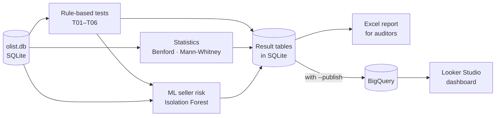
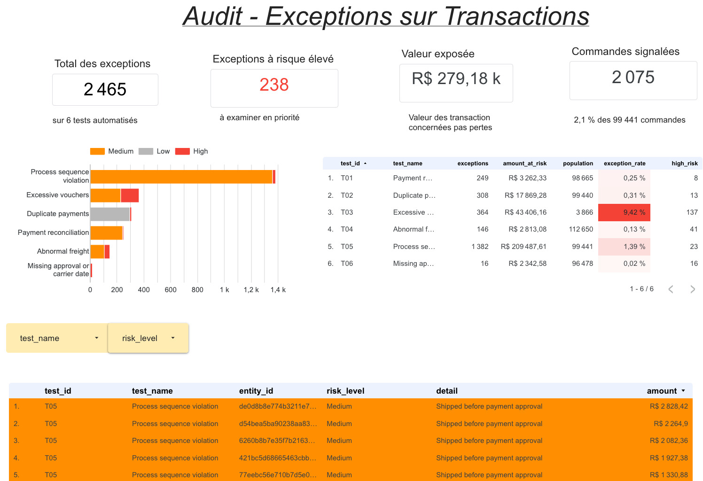
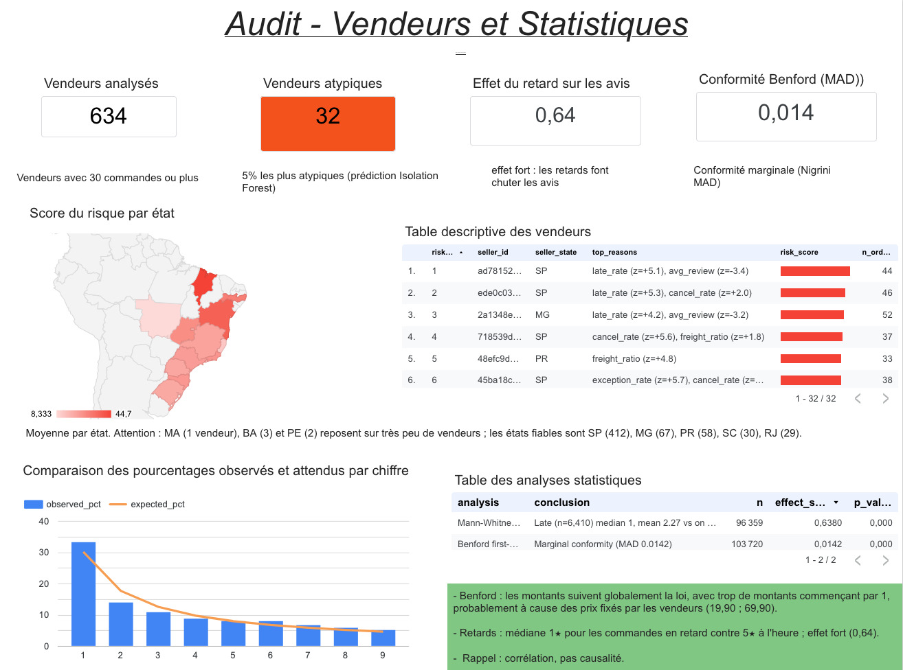
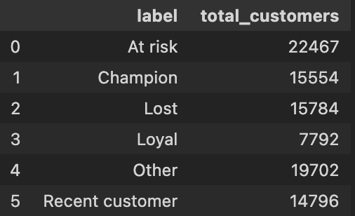

# 🔎 Audit Analytics Toolkit: Olist E-Commerce Transactions

An automated **internal-audit analytics** toolkit built on 100k real transactions from Olist, a Brazilian e-commerce marketplace (2016–2018).

Instead of checking a sample, it tests **100% of transactions**, using:
- **rule-based audit tests**
- **statistical analyses** (Benford's law, hypothesis testing)
- a **machine-learning risk model** that ranks sellers for review

Results go to the people who use them: an **Excel workpaper** for auditors, and a **Looker Studio dashboard** for audit management.

```bash
python run_audit.py            # run every test, save the results, write the Excel report
python run_audit.py --publish  # ...and refresh the dashboard data in BigQuery
```

---

## Architecture



| Step | Code | What it does |
|---|---|---|
| Data access | `audit/db.py` | Connection to `olist.db` and a `read_sql()` helper |
| Rule-based tests | `audit/tests.py` | 6 audit tests in one standard exception format, plus a registry with each test's population |
| Statistics | `audit/statistics.py` | Benford's law (chi-square + MAD), Mann-Whitney U test |
| Machine learning | `audit/seller_risk.py` | Seller features, Isolation Forest risk score, explanations |
| Outputs | `audit/report.py` | Excel report, BigQuery publish |
| Orchestration | `run_audit.py` | Runs everything in order; `--publish` flag |
| Exploration | `audit_analysis.ipynb` | Charts and interpretation (seaborn) |
| Documentation | [`docs/audit_test_catalogue.md`](docs/audit_test_catalogue.md) | Control, risk, logic, threshold and limitations of every test |

---

## Key findings (run of 2026-11-16)

### Rule-based tests: 2,465 exceptions, 238 high risk

| Test | Control checked | Exceptions | High | Population | Rate |
|---|---|---|---|---|---|
| T01 Payment reconciliation | Paid = invoiced (items + freight) | 249 | 8 | 98,665 orders | 0.25% |
| T02 Duplicate payments | Each payment recorded once | 308 | 13 | 99,440 orders | 0.31% |
| T03 Excessive vouchers | Vouchers limited per order | 364 | 137 | 3,866 voucher orders | 9.42% |
| T04 Abnormal freight | Freight reasonable vs item price | 146 | 41 | 112,650 order items | 0.13% |
| T05 Process sequence violation | Approval → shipping → delivery order respected | 1,382 | 23 | 99,441 orders | 1.39% |
| T06 Missing approval / carrier date | Delivered orders have a full audit trail | 16 | 16 | 96,478 delivered | 0.02% |

- **T01:** 97% of the gaps are credit-card orders with many instalments (6.3 on average vs 2.9). They are likely **instalment interest**, i.e. explainable false positives. The real follow-up is the **17 underpaid orders**.
- **T05:** 1,359 orders were handed to the carrier **before payment approval**: a control bypass to discuss with the process owner.
- **T03:** the high rate reflects a small population (voucher orders only). Always read a rate with its "out of how many".

### Statistics
- **Benford's law** (103,720 payments): chi-square p < 0.001, but **MAD = 0.0142, i.e. marginal conformity**. With this many rows, chi-square flags even tiny differences, so MAD measures the size of the deviation. Too many amounts start with 1, likely because of seller price points (19.90, 69.90). **Next step:** run it per seller.
- **Late delivery vs reviews** (Mann-Whitney U): late orders have a median of 1★, on-time orders 5★. p < 0.001 and **effect size 0.64 (large)**: significant *and* material. It's a correlation, not proof of causation.

### Machine learning: seller risk
An **Isolation Forest** scores 634 sellers (30+ orders) on 6 behavioural features and flags **32 outliers (5%)**. Each one comes with its reasons, e.g. `late_rate (z=+5.1), avg_review (z=-3.4)`.
- **Unsupervised by design:** no seller is labelled as fraudulent.
- **"Unusual is not the same as risky":** only features that deviate in the risky direction are shown as reasons.
- **Rules and ML agree on some sellers:** the rank-6 seller has 15.8% of its orders flagged by the audit tests.

---

## Dashboard (Looker Studio)

**Page 1: Exceptions.** KPIs, exceptions by test and risk level, a summary table, and a filterable detail table.



**Page 2: Seller risk & statistics.** KPIs, the seller risk ranking with reasons, a map of average risk by state, the Benford chart, and the statistical results.



**Design principle:** all logic lives in Python and SQL, and the dashboard only displays and filters. The same tables would feed **Power BI** without changing any number:

| Looker Studio | Power BI |
|---|---|
| Data source (BigQuery table) | Semantic model (Import / DirectQuery) |
| Calculated field | DAX measure or calculated column |
| Drop-down control | Slicer |
| Scorecard | Card / KPI visual |
| Conditional formatting | Conditional formatting |
| Geo chart | Filled map |
| Data freshness | Scheduled refresh |

---

## How to run

1. **Data:** download the [Brazilian E-Commerce Public Dataset by Olist](https://www.kaggle.com/datasets/olistbr/brazilian-ecommerce) from Kaggle into `data/`, then build `olist.db` with `load_data.ipynb`.
2. **Environment:**
   ```bash
   python3 -m venv .vex && source .vex/bin/activate
   pip install -r requirements.txt
   ```
3. **Run:** `python run_audit.py`. It prints the summary and writes `reports/audit_report_<date>.xlsx`.
4. **Publish (optional):** put a Google service-account key in `bq_creds.json` (git-ignored), then run `python run_audit.py --publish`.

**Tech stack:** Python 3.9 · pandas · SQL (SQLite, BigQuery) · scikit-learn · SciPy · seaborn · openpyxl · Looker Studio

## Project structure
```text
├── audit/
│   ├── db.py              # database connection + read_sql()
│   ├── tests.py           # rule-based audit tests T01–T06 + registry
│   ├── statistics.py      # Benford's law, Mann-Whitney U
│   ├── seller_risk.py     # features + Isolation Forest + explanations
│   └── report.py          # Excel report + BigQuery publish
├── run_audit.py           # entry point (--publish)
├── audit_analysis.ipynb   # charts and interpretation
├── docs/
│   └── audit_test_catalogue.md
├── load_data.ipynb        # loads the raw CSVs (SQLite / BigQuery) + earlier SQL exploration
├── RFM_model.ipynb        # earlier customer segmentation (RFM)
├── queries/               # earlier SQL queries
├── assets/                # images for this README
├── data/                  # raw CSVs (git-ignored)
└── reports/               # generated Excel reports (git-ignored)
```

---

## Limitations and next steps
- **Refine T01** to allow for instalment interest, so only unexplained gaps remain.
- **Benford per seller**, to find which sellers drive the deviation.
- **Calibrate thresholds** (vouchers, freight) with the business owners, and use product weight and distance in T04.
- **Schedule the run**, e.g. daily, for **continuous auditing**, and track exceptions through review and follow-up.
- **GenAI:** classify the 40,968 free-text review comments (non-delivery, wrong item, damaged…) with an LLM to add a complaint-based risk signal. Human review would stay in the loop, and confidential data wouldn't be sent to a public API.

---

## Previous analysis: business insights and customer segmentation
Before the audit toolkit, this repository was a SQL analytics project on the same data:
- **Logistics drive satisfaction:** orders delivered on time average 4.29★, late deliveries 2.27★. The audit toolkit re-tested this with Mann-Whitney U and corrected the earlier figure of 2.34, which had counted canceled orders as late.
- **Payments:** credit cards generate over 12.5M BRL, with 3.5 instalments on average.
- **Product quality:** `fraldas_higiene` (3.25★) and `moveis_escritorio` (3.49★) have the lowest review scores among categories with 30+ reviews.
- **RFM segmentation** in SQL (CTEs, window functions): Champions 15,554 · Loyal 7,792 · Recent 14,796 · At risk 22,467 · Lost 15,784 · Other 19,702.


